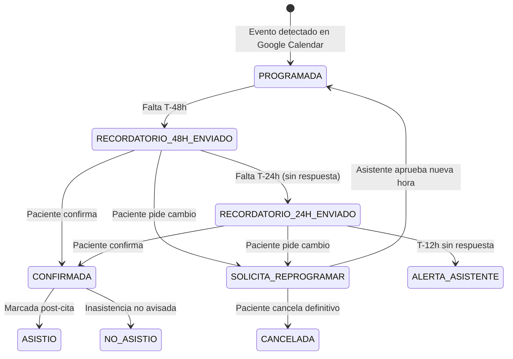

---
tags:
  - curso/ia
  - spec
  - product-engineering
  - sdd
tipo: especificacion
curso: "[[Product Engineer con AI - CódigoFacilito]]"
tarea: "Tarea 2 - Spec-Driven Development (SDD)"
fecha: 2026-11-02
estado: completado
---

# ESPECIFICACIÓN TÉCNICA (SDD) — Sistema Asistente Dental: Agenda y Retención

**Rol del autor:** Senior Product Engineer  
**Metodología:** Spec-Anchored Development (Nivel 2 de SDD)  
**Entorno regulatorio:** Colombia (Ley Estatutaria 1581 de 2012 — Régimen General de Protección de Datos Personales)  
**Fuente de verdad de agenda:** Google Calendar  

---

## 1. Visión y Objetivos Medibles

### 1.1 Problema Operativo
Un consultorio odontológico atendido por 1 odontóloga y 1 asistente pierde cerca del 30% de sus citas por inasistencia no avisada (*no-show*), perdiendo ingresos y capacidad instalada. Además, los tratamientos de alto valor y múltiples citas (endodoncias, ortodoncias) se abandonan a la mitad por falta de seguimiento proactivo, y la asistente dedica más de dos horas de su jornada matutina a redactar y enviar recordatorios manuales por WhatsApp uno por uno.

### 1.2 Objetivos de Producto (Métricas de Éxito)
1. **Reducción del absentismo:** Bajar la tasa de inasistencia del 30% actual a un $\le 12\%$ en los primeros 60 días de operación.
2. **Eficiencia operativa:** Reducir a 0 minutos el envío manual de recordatorios preventivos rutinarios.
3. **Optimización de agenda:** Reasignar al menos el 50% de las cancelaciones o reprogramaciones con pacientes de la lista de espera en menos de 2 horas desde la liberación del espacio.
4. **Retención de tratamientos:** 100% de tratamientos multisesión activos con alerta de seguimiento antes de cumplir 7 días sin próxima cita programada.

### 1.3 Límites Estrictos del Sistema (Fuera de Alcance)
* **Cero datos clínicos:** Queda expresamente prohibido almacenar diagnósticos, historias clínicas, anamnesis, radiografías o recetas médicas. Solo se procesan metadatos operativos (nombres, teléfonos, fechas de cita y categoría administrativa general).
* **Google Calendar como fuente de verdad:** El sistema no crea una agenda paralela. La disponibilidad y los bloqueos reales residen en Google Calendar; el sistema sincroniza eventos y actualiza estados visuales (ej. prefijo `[CONFIRMADA]`).
* **Control humano estricto (Human-in-the-Loop):** La IA propone reasignaciones, pero la asistente aprueba de forma explícita todo cambio en la agenda. Ninguna cita se reprograma ni se cancela en Google Calendar de manera 100% autónoma por el modelo.

---

## 2. Decisiones de Arquitectura y Principio de Determinismo

1. **Separación estricta de responsabilidades:**
   * **Determinista (Código convencional):** Monitoreo de horarios, cálculo de ventanas temporales (48h / 24h / 12h), transiciones de la máquina de estados, validación de números E.164, matching de lista de espera y llamadas a APIs.
   * **Probabilístico (LLM - Claude API / Claude 3.5 Sonnet o Haiku):** Exclusivamente parsing de respuestas abiertas en lenguaje natural informal (español coloquial colombiano) hacia un esquema JSON rígido y tipado.
2. **Privacidad y Habeas Data (Colombia):**
   * Registro explícito de `consentimiento_datos` (`BOOLEAN`) y marca temporal `fecha_consentimiento` para cumplir con la Ley 1581 de 2012.
3. **Mecanismo de seguridad Dry-Run:**
   * Variable de entorno `DISPATCH_MODE=DRY_RUN` activa por defecto. Ningún mensaje de WhatsApp ni modificación de Google Calendar se ejecuta sin autorización explícita.

---

## 3. Modelo de Datos Relacional (PostgreSQL)

```sql
-- Extensión requerida para claves UUID
CREATE EXTENSION IF NOT EXISTS "uuid-ossp";

-- 1. Pacientes (estrictamente administrativo)
CREATE TABLE pacientes (
    id UUID PRIMARY KEY DEFAULT uuid_generate_v4(),
    nombre_completo VARCHAR(150) NOT NULL,
    telefono_e164 VARCHAR(20) NOT NULL UNIQUE, -- Ejemplo: +573001234567
    consentimiento_datos BOOLEAN NOT NULL DEFAULT FALSE,
    fecha_consentimiento TIMESTAMP WITH TIME ZONE,
    creado_en TIMESTAMP WITH TIME ZONE DEFAULT NOW()
);

CREATE INDEX idx_pacientes_telefono ON pacientes(telefono_e164);

-- 2. Planes de tratamiento (categoría administrativa de seguimiento)
CREATE TYPE tipo_tratamiento_enum AS ENUM (
    'VALORACION_INICIAL',
    'CONTROL_GENERAL',
    'LIMPIEZA',
    'ORTODONCIA',
    'ENDODONCIA',
    'OTRO'
);

CREATE TYPE estado_plan_enum AS ENUM (
    'ACTIVO',
    'FINALIZADO',
    'EN_RIESGO_ABANDONO',
    'ABANDONADO'
);

CREATE TABLE planes_tratamiento (
    id UUID PRIMARY KEY DEFAULT uuid_generate_v4(),
    paciente_id UUID NOT NULL REFERENCES pacientes(id) ON DELETE RESTRICT,
    tipo tipo_tratamiento_enum NOT NULL,
    total_sesiones_estimadas INT NOT NULL DEFAULT 1,
    sesiones_completadas INT NOT NULL DEFAULT 0,
    estado estado_plan_enum NOT NULL DEFAULT 'ACTIVO',
    dias_maximos_entre_citas INT NOT NULL DEFAULT 30,
    creado_en TIMESTAMP WITH TIME ZONE DEFAULT NOW(),
    actualizado_en TIMESTAMP WITH TIME ZONE DEFAULT NOW()
);

-- 3. Citas sincronizadas con Google Calendar
CREATE TYPE estado_cita_enum AS ENUM (
    'PROGRAMADA',
    'RECORDATORIO_48H_ENVIADO',
    'RECORDATORIO_24H_ENVIADO',
    'CONFIRMADA',
    'SOLICITA_REPROGRAMAR',
    'CANCELADA',
    'ASISTIO',
    'NO_ASISTIO'
);

CREATE TABLE citas (
    id UUID PRIMARY KEY DEFAULT uuid_generate_v4(),
    google_event_id VARCHAR(255) NOT NULL UNIQUE,
    paciente_id UUID NOT NULL REFERENCES pacientes(id) ON DELETE RESTRICT,
    plan_tratamiento_id UUID REFERENCES planes_tratamiento(id) ON DELETE SET NULL,
    inicio_en TIMESTAMP WITH TIME ZONE NOT NULL,
    fin_en TIMESTAMP WITH TIME ZONE NOT NULL,
    estado estado_cita_enum NOT NULL DEFAULT 'PROGRAMADA',
    notas_asistente TEXT,
    creado_en TIMESTAMP WITH TIME ZONE DEFAULT NOW(),
    actualizado_en TIMESTAMP WITH TIME ZONE DEFAULT NOW()
);

CREATE INDEX idx_citas_rango ON citas(inicio_en, fin_en);
CREATE INDEX idx_citas_estado ON citas(estado);

-- 4. Mensajes y Auditoría de Decisiones de IA
CREATE TYPE canal_mensaje_enum AS ENUM ('WHATSAPP_SIMULADO', 'WHATSAPP_REAL');
CREATE TYPE direccion_mensaje_enum AS ENUM ('SALIENTE', 'ENTRANTE');

CREATE TABLE mensajes (
    id UUID PRIMARY KEY DEFAULT uuid_generate_v4(),
    cita_id UUID REFERENCES citas(id) ON DELETE SET NULL,
    paciente_id UUID NOT NULL REFERENCES pacientes(id) ON DELETE RESTRICT,
    direccion direccion_mensaje_enum NOT NULL,
    canal canal_mensaje_enum NOT NULL DEFAULT 'WHATSAPP_SIMULADO',
    cuerpo_texto TEXT NOT NULL,
    clasificacion_ia JSONB, -- Registro auditable de inferencia
    tokens_utilizados INT DEFAULT 0,
    modelo_utilizado VARCHAR(50),
    creado_en TIMESTAMP WITH TIME ZONE DEFAULT NOW()
);

-- 5. Lista de espera para cobertura de cancelaciones
CREATE TYPE estado_espera_enum AS ENUM ('PENDIENTE', 'NOTIFICADO', 'REASIGNADO', 'EXPIRADO');

CREATE TABLE lista_espera (
    id UUID PRIMARY KEY DEFAULT uuid_generate_v4(),
    paciente_id UUID NOT NULL REFERENCES pacientes(id) ON DELETE RESTRICT,
    tipo_tratamiento tipo_tratamiento_enum NOT NULL,
    disponibilidad_franja VARCHAR(100) NOT NULL, -- Ej: 'Tardes despues de las 2pm'
    estado estado_espera_enum NOT NULL DEFAULT 'PENDIENTE',
    fecha_limite DATE,
    creado_en TIMESTAMP WITH TIME ZONE DEFAULT NOW()
);
```

---

## 4. Máquina de Estados y Ciclo de Recordatorios



### Reglas Deterministas de Disparo
* **Ventana T-48 horas:** Disparo del primer recordatorio estándar:
  > *"Hola [Nombre], te recordamos tu cita odontológica para el [Día] a las [Hora]. Por favor responde: 1 para Confirmar o 2 si necesitas Reprogramar."*
* **Ventana T-24 horas:** Si la cita continúa en `RECORDATORIO_48H_ENVIADO`, se envía el segundo recordatorio con tono de confirmación prioritaria.
* **Ventana T-12 horas:** Si no se ha recibido confirmación, la cita transiciona internamente a estado de atención prioritaria y se genera una alerta visual destacada en el panel de la asistente.

---

## 5. Especificación del Clasificador de IA (Claude API)

### 5.1 Contrato del JSON Schema
```json
{
  "$schema": "http://json-schema.org/draft-07/schema#",
  "type": "object",
  "properties": {
    "intencion": {
      "type": "string",
      "enum": ["CONFIRMAR", "REPROGRAMAR", "CANCELAR", "DUDA_HORARIO", "NO_RECONOCIDO"]
    },
    "confianza": {
      "type": "number",
      "minimum": 0.0,
      "maximum": 1.0
    },
    "fecha_propuesta": {
      "type": ["string", "null"],
      "description": "Texto exacto o interpretación de fecha/hora si el paciente la sugiere; null en otro caso."
    },
    "requiere_humano": {
      "type": "boolean",
      "description": "True si confianza < 0.85, la intención es NO_RECONOCIDO o hay una queja médica."
    }
  },
  "required": ["intencion", "confianza", "fecha_propuesta", "requiere_humano"],
  "additionalProperties": false
}
```

### 5.2 Suite de Pruebas: 20 Casos en Español Coloquial Colombiano

| # | Mensaje del paciente | Intención esperada | Requiere humano |
|---|---|---|---|
| 1 | "De una doc, allá estaré firme" | `CONFIRMAR` | `false` |
| 2 | "Listo, cuente con eso" | `CONFIRMAR` | `false` |
| 3 | "Buenas, sí señora allá caigo a esa hora" | `CONFIRMAR` | `false` |
| 4 | "Sisas, allá llego" | `CONFIRMAR` | `false` |
| 5 | "Sisi confirmo" | `CONFIRMAR` | `false` |
| 6 | "Me salió un chicharrón en el camello, me toca moverla" | `REPROGRAMAR` | `false` |
| 7 | "Vecina qué pena, ¿será que me la puede pasar pal viernes en la tardecita?" | `REPROGRAMAR` | `false` |
| 8 | "Se me cruzó con una vuelta del banco, ¿hay campo el lunes?" | `REPROGRAMAR` | `false` |
| 9 | "No alcanzo a llegar por el trancón tan berraco, ¿la corremos una hora?" | `REPROGRAMAR` | `false` |
| 10 | "¿Tienen un huequito para la otra semana? Es que estoy fuera de Bogotá" | `REPROGRAMAR` | `false` |
| 11 | "Definitivamente no puedo seguir con el tratamiento, muchas gracias" | `CANCELAR` | `false` |
| 12 | "Cancelemos eso por ahora que ando sin plata" | `CANCELAR` | `false` |
| 13 | "Ya no me sirve, borren la cita porfa" | `CANCELAR` | `false` |
| 14 | "¿A qué hora fue que me dijeron? Se me embolató el mensaje" | `DUDA_HORARIO` | `false` |
| 15 | "Buenos días, ¿me repite la hora por favor?" | `DUDA_HORARIO` | `false` |
| 16 | "Parce tengo la muela que me estalla, necesito que me atiendan ya" | `NO_RECONOCIDO` | `true` |
| 17 | "¿Cuánto vale la calzadura blanca?" | `NO_RECONOCIDO` | `true` |
| 18 | "[Audio recibido de 0:15]" | `NO_RECONOCIDO` | `true` |
| 19 | "👍" | `CONFIRMAR` | `false` |
| 20 | "No sé si alcance, le confirmo en un rato" | `NO_RECONOCIDO` | `true` |

---

## 6. Algoritmo de Lista de Espera y Reposición de Huecos

1. **Evento disparador:** Una cita existente pasa a estado `CANCELADA` o `SOLICITA_REPROGRAMAR` con al menos 4 horas de anticipación a `inicio_en`.
2. **Búsqueda determinista:**
   * Extraer `tipo_tratamiento` y rango horario del espacio liberado.
   * Ejecutar consulta a `lista_espera`:
     ```sql
     SELECT le.id, le.paciente_id, p.nombre_completo, p.telefono_e164
     FROM lista_espera le
     JOIN pacientes p ON p.id = le.paciente_id
     WHERE le.estado = 'PENDIENTE'
       AND le.tipo_tratamiento = $1
       AND (le.fecha_limite IS NULL OR le.fecha_limite >= CURRENT_DATE)
     ORDER BY le.creado_en ASC
     LIMIT 1;
     ```
3. **Propuesta a la asistente:**
   * El sistema genera una notificación en la interfaz:
     > *"Hueco liberado hoy a las 3:00 PM (45 min). Candidato en lista de espera: [Nombre] ([Teléfono]). ¿Desea que el sistema le ofrezca el espacio vía WhatsApp? [Aprobar envío] [Descartar]"*
4. **Reserva condicionada:** Al aprobarse el envío, el espacio se congela por 30 minutos con un temporizador. Si el paciente no confirma o rechaza, el sistema propone al siguiente candidato en lista.

---

## 7. Detección y Prevención de Abandono de Tratamientos

* **Job automatizado diario:** Ejecución programada a las 08:00 AM (hora Colombia).
* **Consulta de detección:**
  ```sql
  SELECT 
      pt.id AS plan_id,
      p.nombre_completo,
      p.telefono_e164,
      pt.tipo AS tratamiento,
      pt.sesiones_completadas,
      pt.total_sesiones_estimadas,
      MAX(c.inicio_en) AS ultima_cita
  FROM planes_tratamiento pt
  JOIN pacientes p ON p.id = pt.paciente_id
  LEFT JOIN citas c ON c.plan_tratamiento_id = pt.id AND c.estado = 'ASISTIO'
  WHERE pt.estado = 'ACTIVO'
    AND pt.sesiones_completadas < pt.total_sesiones_estimadas
    AND NOT EXISTS (
        SELECT 1 FROM citas c_futura
        WHERE c_futura.plan_tratamiento_id = pt.id
          AND c_futura.inicio_en >= NOW()
          AND c_futura.estado NOT IN ('CANCELADA', 'NO_ASISTIO')
    )
  GROUP BY pt.id, p.nombre_completo, p.telefono_e164, pt.tipo, pt.sesiones_completadas, pt.total_sesiones_estimadas, pt.dias_maximos_entre_citas
  HAVING COALESCE(MAX(c.inicio_en), pt.creado_en) < (NOW() - (pt.dias_maximos_entre_citas || ' days')::INTERVAL);
  ```
* **Acción resultante:** Actualización del plan a `EN_RIESGO_ABANDONO` y creación de una tarjeta de gestión en la vista *Seguimiento de Tratamientos* para contacto telefónico directo por parte de la asistente.

---

## 8. Criterios de Aceptación y Verificación

1. **Zero Clinical Data Leakage:** Ninguna tabla, log o llamada a la API de LLM contiene diagnósticos médicos o datos clínicos sensibles.
2. **Auditabilidad total:** Cada inferencia del clasificador guarda en base de datos el input de texto, salida JSON, confianza calculada, tokens y modelo utilizado.
3. **Resistencia a fallos:** Si la API de Claude no responde o entrega JSON inválido en 3 reintentos con backoff exponencial, la cita transiciona de forma determinista a `requiere_humano = true` sin interrumpir la operación.
4. **Verificación de pruebas:**
   * Pruebas unitarias de esquema SQL y constraints.
   * Prueba automatizada del clasificador evaluando los 20 casos de prueba colombianos con precisión $\ge 90\%$.
   * Prueba del flujo de lista de espera respetando orden FIFO por fecha de registro.
